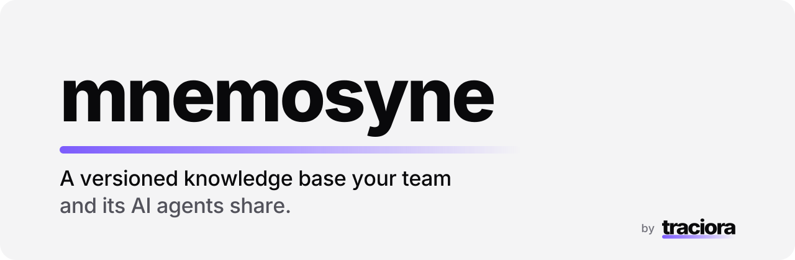
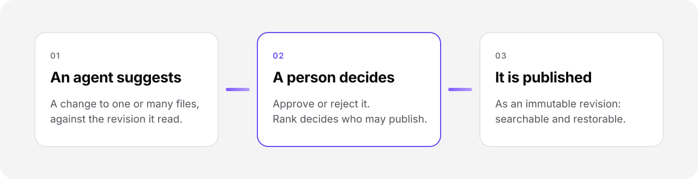

<picture>
  <source media="(prefers-color-scheme: dark)" srcset="docs/assets/hero-dark.svg">
  
</picture>

**Mnemosyne is a versioned knowledge base your team and its AI agents share.
Ranks decide who sees what, people publish, agents suggest.**

Teams now let AI agents read their documents, and soon want agents to keep them current.
That needs a store that can answer three questions at any moment: who can see this,
who changed it, and who agreed to the change. Mnemosyne is that store. It is a
single Rust binary you run next to your app, with a typed JSON API and a Python client.

## How it works

<picture>
  <source media="(prefers-color-scheme: dark)" srcset="docs/assets/flow-dark.svg">
  
</picture>

Agents never write directly. They propose an exact change against the revision they read.
A person whose rank allows it approves or rejects it. An approval is bound to that exact
change: it cannot be reused for edited content, a stale base or revoked rights.

## What you get

- **History you can trust.** Every change is an immutable multi-file revision with author,
  message and reason. Diff any two revisions, follow renames, restore any version.
- **Ranks and visibility.** A ladder like *junior → senior → administrator* decides who
  proposes and who publishes, and each folder decides who may see it. Hidden files stay hidden everywhere: in search,
  counts, links and history.
- **Search that reads your files.** Ranked full-text search in English, Russian and mixed text.
  PDF, DOCX and PPTX are extracted with page and section references. Optional semantic
  search runs on a local model; nothing leaves your machine.
- **A graph your agents can walk.** Links, backlinks, headings and neighbourhoods,
  so an agent finds the right page in one call instead of ten.
- **Bring your files.** Import a folder of Markdown and documents; export it back with paths
  and original bytes intact.
- **Built to run unattended.** One local service, backup and restore, retention and
  garbage collection, and crash recovery.

## Quick start

```bash
cargo build --release
mnemosyne content-init  --store ./store --policy policy.json
mkdir -m 700 run
mnemosyne content-serve --store ./store --credentials credentials.json --socket run/content.sock
pip install ./clients/python
```

`policy.json` says who may read, propose and approve; `credentials.json` maps tokens to
people and agents. Then follow [Getting started](docs/getting-started.md) for a first propose-and-approve round trip.

## Also a vault CLI

Mnemosyne ships a command-line tool for Markdown vaults: create, search, properties, tasks,
bookmarks, links and more. Much of it is inspired by [Obsidian](https://obsidian.md), and its
CLI commands behave as they do in Obsidian. See [Vault CLI](docs/vault-cli.md).

## Documentation

[Concepts](docs/concepts.md) · [Getting started](docs/getting-started.md) ·
[Permissions](docs/permissions.md) · [Search](docs/search.md) · [API](docs/api.md) ·
[Python client](docs/python-client.md) · [Operations](docs/operations.md) ·
[Vault CLI](docs/vault-cli.md)

## License

[Apache-2.0](LICENSE). Made by [Traciora](https://traciora.com).
